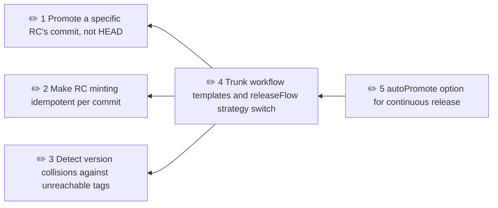

# Plans

Planned work for the gradle-versioning plugins.

<!-- brindley:generated:begin — do not edit by hand; regenerate instead -->

### Active

| # | Initiative | Type | Status | Ready / blocked by | Open Qs | Owner |
|---|------------|------|--------|--------------------|---------|-------|
| 1 | [Promote a specific RC's commit, not HEAD](01-promote-a-specific-rc-s-commit-not-head.md) | feature | draft | — | 0 | — |
| 2 | [Make RC minting idempotent per commit](02-make-rc-minting-idempotent-per-commit.md) | bug | draft | — | 0 | — |
| 3 | [Detect version collisions against unreachable tags](03-detect-version-collisions-against-unreachable-tags.md) | bug | draft | — | 0 | — |
| 4 | [Trunk workflow templates and releaseFlow strategy switch](04-trunk-workflow-templates-and-releaseflow-strategy-switch.md) | feature | draft | ⛔ 1, 2, 3 | 0 | — |
| 5 | [autoPromote option for continuous release](05-autopromote-option-for-continuous-release.md) | feature | draft | ⛔ 4 | 0 | — |

### Dependencies

### Themes

- **trunk-based** — Support a single-branch, trunk-based release flow alongside develop → release → main · 5 open, 0 closed or deferred

### Completed

_None._

<!-- brindley:generated:end -->
